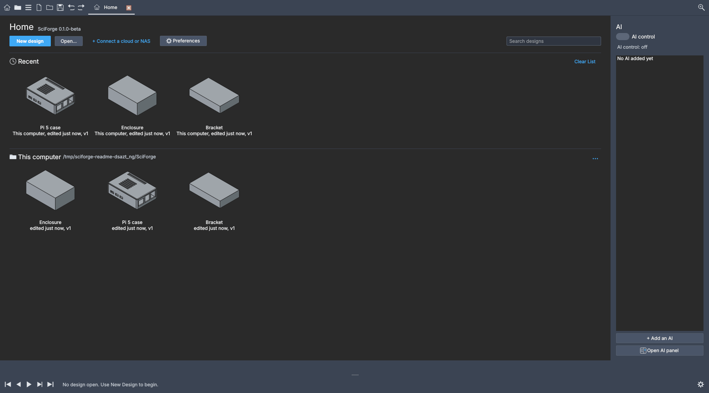
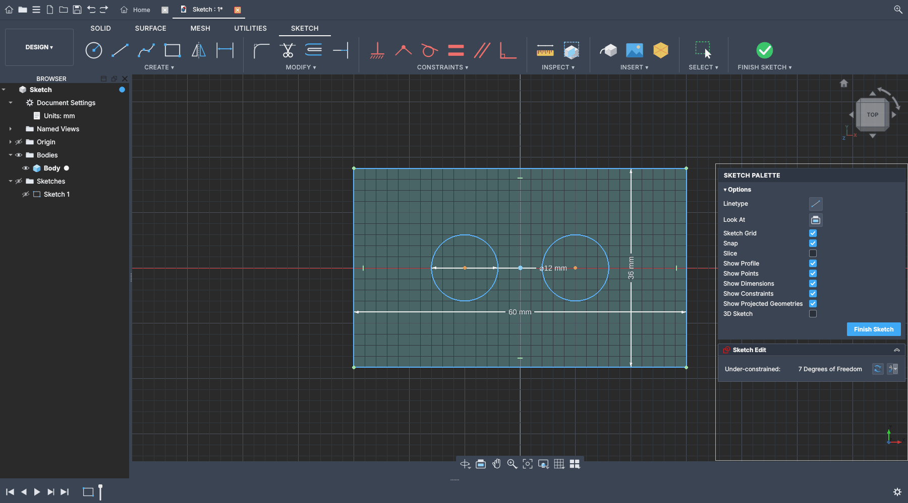
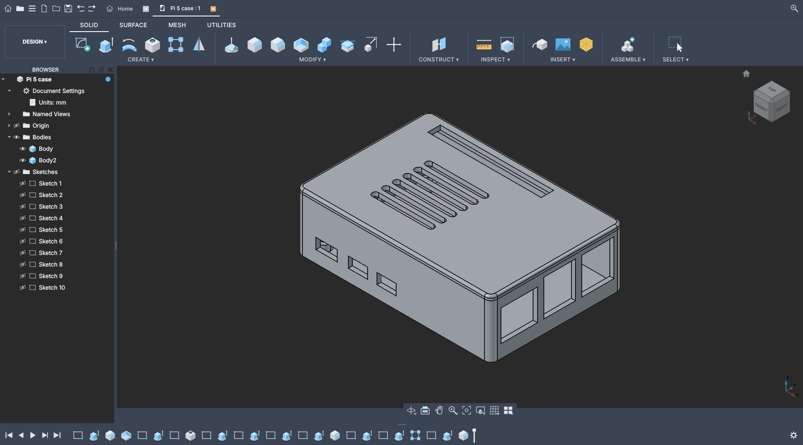
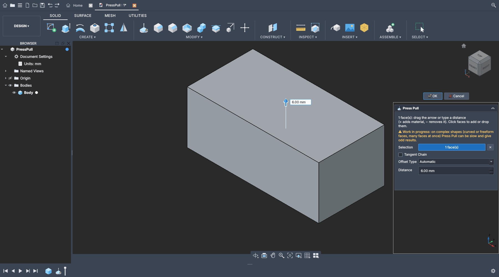
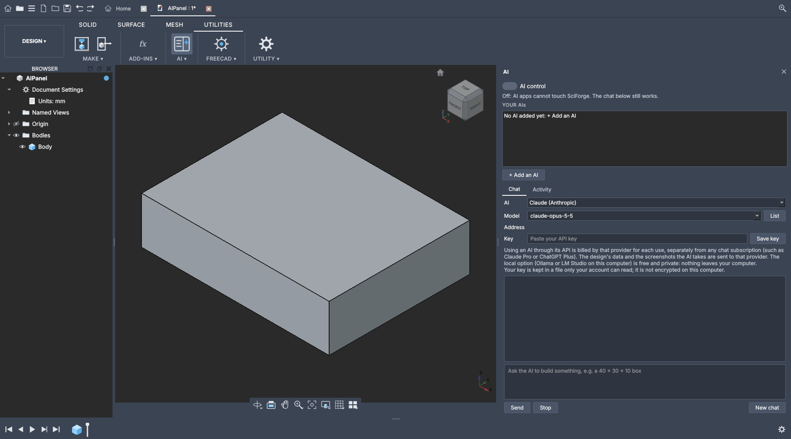

<!-- SCIFORGE: SciForge's own README. FreeCAD's original is README.FreeCAD.md (core-patches.md #5).
     The block between the two "smartscreen" markers is docs/sciforge/smartscreen.md word for word
     (a unit test checks it); change that file, then copy the text here. -->
<div align="center">

# SciForge

**Parametric CAD that works the way Fusion users expect. Free and open source, based on FreeCAD.**

  

[**Download**](https://github.com/Luca0422git/SciForge/releases) ·
[What works](#what-works-and-what-does-not-yet) ·
[Known issues](docs/sciforge/known-issues.md) ·
[Cheat sheet](docs/sciforge/cheat-sheet.md) ·
[Privacy](docs/sciforge/privacy.md) ·
[Changelog](CHANGELOG.md)



</div>

SciForge is a free CAD program for 3D design: sketches with dimensions and constraints, solid
modeling with a timeline you can edit afterwards, Press Pull, components and joints, surfaces,
meshes, drawings and 3D printing. If you know Fusion, you know SciForge: the ribbon, the browser,
the timeline, the navigation bar, `S` for command search and Fusion's keys and mouse are all
there. It is built on [FreeCAD](https://www.freecad.org), which does the heavy geometry work, and
adds its own interface and tools on top.

**This is a beta (0.1.0-beta).** Every feature is tested automatically by driving the real
program with clicks and keys, but SciForge has had little use by anyone except the person
building it, so expect rough edges. Save often, and read the
[known issues](docs/sciforge/known-issues.md) before you start. Your feedback is what makes the
next beta better.

| Sketching, with the sketch palette | The timeline, with a finished design |
|---|---|
|  |  |
| **Press Pull, with its arrow** | **The AI panel** |
|  |  |

## Download and install

**[Go to the Releases page](https://github.com/Luca0422git/SciForge/releases)** and pick the
newest release at the top (SciForge 0.1.0-beta is a "pre-release", which is why GitHub's
"latest" button does not show it).

### Which file to take

| You use | Take this file | Notes |
|---|---|---|
| **Windows 10 or 11** (recommended) | `SciForge_...-installer.exe` | Installs to `C:\Program Files\SciForge`, adds a Start menu entry and an uninstaller. A FreeCAD you already have is not touched. |
| Windows, without installing | `SciForge_...-Windows-...7z` | Unpack it with [7-Zip](https://www.7-zip.org) anywhere (for example `C:\SciForge`) and run `bin\SciForge.exe`. Nothing is installed or registered. |
| **Linux** (64-bit) | `SciForge_...AppImage` | Make it executable (`chmod +x SciForge_...AppImage`) and run it. If your system lacks FUSE, run it with `--appimage-extract` first. |

Next to the downloads there is a checksum file (`SHA256SUMS.txt`) to check that your copy is the
real one (see the next section).

### What your computer needs

- **Windows 10 or 11, 64-bit**, or **Linux on a 64-bit Intel/AMD processor** (x86-64). There is
  **no macOS version**.
- A graphics card and driver with OpenGL support. SciForge draws 3D with FreeCAD's engine, and
  FreeCAD's code states that it "requires OpenGL 2.0 or above" and warns at start-up when the
  system is older (`src/Gui/StartupProcess.cpp`). Any PC from roughly the last ten years with an
  up-to-date graphics driver should be fine; if the 3D view stays black, update the driver first.
- About **3 GB** of free disk space for the program (it is about as large as FreeCAD itself),
  plus room for your designs.

<!-- smartscreen:begin -->
### "Windows protected your PC" (SciForge is not signed)

When you start the SciForge installer for the first time, Windows may show a blue window called
**Windows protected your PC**. This is normal for SciForge, and it does not mean the download
is broken or dangerous.

**Why it appears.** The installer is not signed with a paid code-signing certificate. Those
certificates cost money every year, and SciForge is free and open source, so it does not have one
yet. Windows (the feature is called Microsoft Defender SmartScreen) warns about every program it
has not seen many times before, signed or not. That is its job, and it is a sensible default. It
only tells you that Windows does not know this program yet, not that anything is wrong with it.

**What to click** (Windows 10 and 11):

1. In the blue window, click **More info** (the small text under the message).
2. The window now shows the file name and says "Publisher: Unknown publisher", and a new button
   **Run anyway** appears. Click **Run anyway**.
3. Windows then asks "Do you want to allow this app to make changes to your device?". Click
   **Yes**. The installer needs this to put SciForge in `C:\Program Files\SciForge`.

If you use the portable download (the `.7z` file), unpack it with 7-Zip and start
`bin\SciForge.exe`. The same blue window can appear the first time; click **More info**, then
**Run anyway**, the same way.

**If your browser already complained while downloading.** Edge and Chrome may say the file "is
not commonly downloaded". In Edge, open the download's `...` menu, click **Keep**, then **Show
more**, then **Keep anyway**. In Chrome, open the download's menu and click **Keep** (and **Keep anyway** if it asks
again). This is the same warning, one step earlier.

**If there is no "More info" link at all.** Right-click the downloaded file, choose
**Properties**, tick **Unblock** at the bottom of the General tab, click **OK**, and start the
file again. (An administrator can also have set Windows to block unknown programs completely. In
that case ask them.)

**Check that your download is the real one (optional, takes a minute).** Every release has a
checksum file, `SHA256SUMS.txt`, next to the downloads on the releases page. A checksum is a
fingerprint of a file. If your copy gives the same fingerprint as the one on the page, nothing
changed it on the way to you. In PowerShell (Start menu, type "PowerShell"), go to your
Downloads folder and run this, with your real file name:

```
cd $HOME\Downloads
Get-FileHash .\SciForge_YOUR_FILE_NAME-installer.exe -Algorithm SHA256
```

Compare the long `Hash` value with the line for the same file in `SHA256SUMS.txt` (capital or
small letters do not matter). If they differ, delete the file, download it again, and if it
still differs, please tell us:
https://github.com/Luca0422git/SciForge/issues

**If your antivirus program blocks or removes the file.** Programs that are new, unsigned, and
bring their own Python and many libraries (like SciForge and FreeCAD, which it is based on) are
sometimes flagged by mistake. This is called a false positive. What to do:

- Do not switch your antivirus off for good. Check the checksum as described above first.
- Look in the antivirus program's quarantine or history list. If it moved the SciForge file
  there and the checksum matched, you can restore it. If you trust the checked download, you can
  tell the antivirus to allow SciForge's folder (usually `C:\Program Files\SciForge`). How to do
  this differs by program; its help page has the steps ("add an exclusion").
- Most antivirus makers have a page to report a false positive; sending them the file helps
  everyone who downloads SciForge after you.
- If you are not comfortable with any of this, wait: nothing is lost by not installing a beta.
  And if you would like help, open an issue and tell us which antivirus program it was.

SciForge never needs an account. The installer puts the program in its own folder
(`C:\Program Files\SciForge`), adds a Start menu entry and an entry in Windows' "Installed apps"
(so you can uninstall it), and only if you tick them, a desktop icon and the `.FCStd` file type.
It leaves an installed FreeCAD alone. All of the source code can be read at
https://github.com/Luca0422git/SciForge
<!-- smartscreen:end -->

## First steps

1. **Start SciForge.** It opens on the **Home** tab: your recent designs, the places they live in,
   and a **New design** button.
2. **New design** (or `Ctrl+N`). You get an empty design with a body. The **ribbon** at the top
   works like Fusion's: SOLID, SURFACE, MESH, UTILITIES, and SKETCH appears while you sketch. The
   **browser** is on the left, the **timeline** at the bottom: click a step to edit it, drag the
   marker to go back in time.
3. **Create Sketch**, click a plane, draw with `L` (line), `R` (rectangle), `C` (circle), dimension
   with `D`, **Finish Sketch**, then `E` for **Extrude** and `Q` for **Press Pull**.
4. **Press `S`** to search every command by name; Enter runs the best match.
5. **Open an example:** [docs/sciforge/examples/pi5-case](docs/sciforge/examples/pi5-case/README.md)
   is a Raspberry Pi 5 case built entirely in SciForge (download `pi5_case.FCStd` and open it
   from Home with **Open...**).

The [cheat sheet](docs/sciforge/cheat-sheet.md) lists Fusion's keys and mouse habits next to what
SciForge does. If you want to know exactly where SciForge still differs from Fusion, the
documents in [docs/sciforge/parity](docs/sciforge/parity) say so for each tool.

## What works, and what does not yet

**Works (and is tested by running it like a person would):** sketches (lines, rectangles, circles,
arcs, polygons, slots, splines, text, dimensions, constraints), Extrude, Revolve, Sweep, Loft,
Press Pull, fillets and chamfers, shell, draft, scale, holes and threads, patterns and mirrors,
components and joints, surfaces, mesh tools, 2D drawings, 3D printing (3MF / STL / send to your
slicer), a hardware library (screws, nuts, washers), measuring and analysis, parameters, version
history for each design, STEP / DXF / SVG / mesh import and export, and **AI connectors** (a chat
panel that uses your own key from Claude, ChatGPT, Gemini or a local model; and a connector so AI
apps like Claude Desktop can build in SciForge, off until you switch it on).

**Does not (yet):** sculpting, simulation, rendering and animation, CAM, electronics, sheet
metal, cloud collaboration, macOS, other languages than English, Fusion's `.f3d` files (export
STEP from Fusion instead), and some options inside tools that exist (shown greyed out, with the
reason). Press Pull is still rough on complex curved shapes. The full, honest list with
workarounds is in **[Known issues](docs/sciforge/known-issues.md)**.

## Updating

SciForge looks for a new version when it starts (at most once a day; you can switch this off in
Preferences > General > "Check for updates when SciForge starts", and **Help > Check for
Updates** checks any time). If there is one, an update icon appears in the top right of the window, next to the search
button (click it for **Update now** or **What's new**), and a line appears at the top of the Home
tab with **What's new**, **Update now** and **Later**. Nothing is installed until you click **Update now**,
and SciForge asks about unsaved designs first.

Updating yourself works too: download the newest installer from the
[Releases page](https://github.com/Luca0422git/SciForge/releases) and run it over the old one (your
settings are in `%APPDATA%\SciForge` and your designs where you saved them, not in the program
folder), or use the small module-only update described in
[docs/sciforge/quick-update.md](docs/sciforge/quick-update.md). On Linux, download the new
AppImage and replace the old file.

## Reporting problems and ideas

- **Something went wrong?** Choose **Help > Report a Problem** in SciForge. It writes down the
  useful details (versions, graphics card, the last SciForge messages, the crash log) with your
  name and folders removed, shows you all of it, and lets you **Open on GitHub** (your browser
  opens a pre-filled form; you need a free GitHub account), **Save** it to a file, or **Copy**
  it. SciForge never sends anything by itself.
- You can also open an issue yourself: **[Issues](https://github.com/Luca0422git/SciForge/issues/new/choose)**
  (a bug report form or an idea form). Say what you did, what happened and what you expected, and
  paste **SciForge > Diagnostics**.
- **Questions, ideas and chatting:** [Discussions](https://github.com/Luca0422git/SciForge/discussions).

## Privacy

SciForge has **no accounts and no telemetry**. By itself it goes online for exactly two things:
the update check (one request to `api.github.com`, which can be switched off in Preferences) and,
only if you connect one, the AI service you chose. AI keys are kept on your computer (Windows:
encrypted for your user), your designs are never uploaded, and cloud places are just folders that
your own cloud app syncs. Every detail, and where in the code to check it, is in
**[docs/sciforge/privacy.md](docs/sciforge/privacy.md)**.

## Building from source

You never need to compile anything to try SciForge: GitHub builds it (Actions > "SciForge build").
How the builds and tests work, and how the code is organised, is described in
**[docs/sciforge/README.md](docs/sciforge/README.md)**. SciForge's own code is the Python module in
`src/Mod/SciForge`; the rest of the repository is FreeCAD's source with a few documented changes
([docs/sciforge/core-patches.md](docs/sciforge/core-patches.md)).

## Licence and credits

SciForge is free software under the **LGPL-2.1-or-later** licence, the same as FreeCAD (see
[LICENSE](LICENSE)). You may use it, also commercially, and share and change it under that
licence.

SciForge is built on **[FreeCAD](https://www.freecad.org)** (version 1.1.4 is inside), and owes
almost everything under the hood to the FreeCAD community and to OpenCASCADE, the geometry
kernel: thank you. SciForge **is not FreeCAD and is not endorsed by the FreeCAD project**; please
do not report SciForge problems to FreeCAD. FreeCAD's original README is kept as
[README.FreeCAD.md](README.FreeCAD.md), and FreeCAD's credits are in SciForge's Help > About.
The anvil logo, SciForge's interface icons and the splash picture are original SciForge artwork.

SciForge is not affiliated with or endorsed by Autodesk. Autodesk and Fusion are trademarks of
Autodesk, Inc. "Fusion" is used on this page only to say who SciForge is made for. SciForge uses
none of Autodesk's logos, icons, colours or text.
